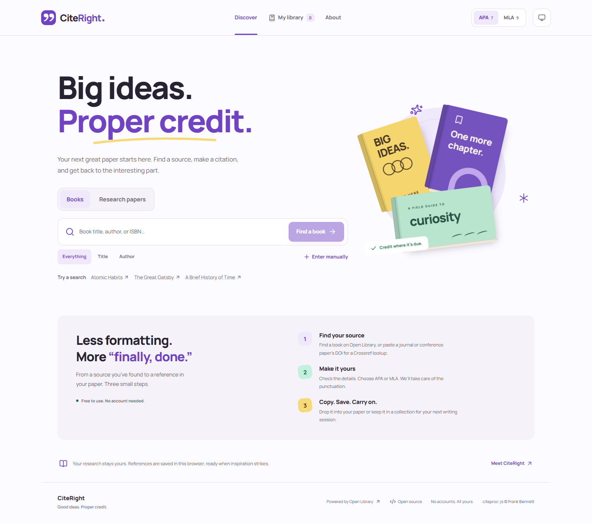
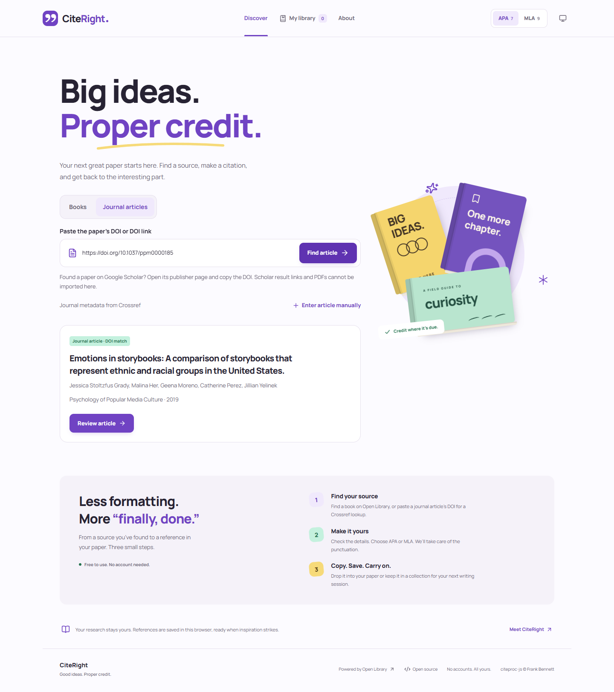
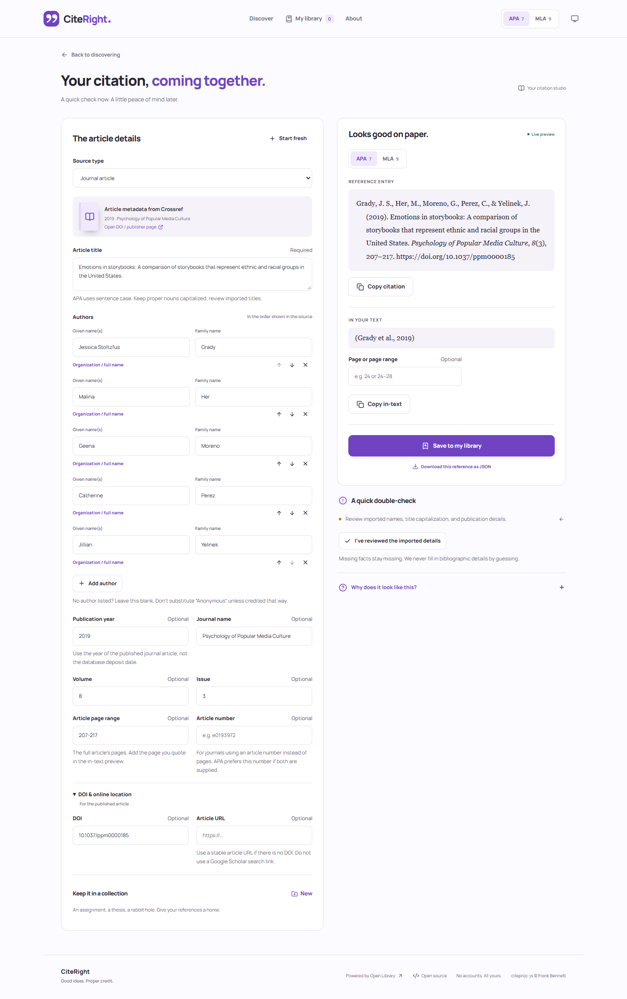
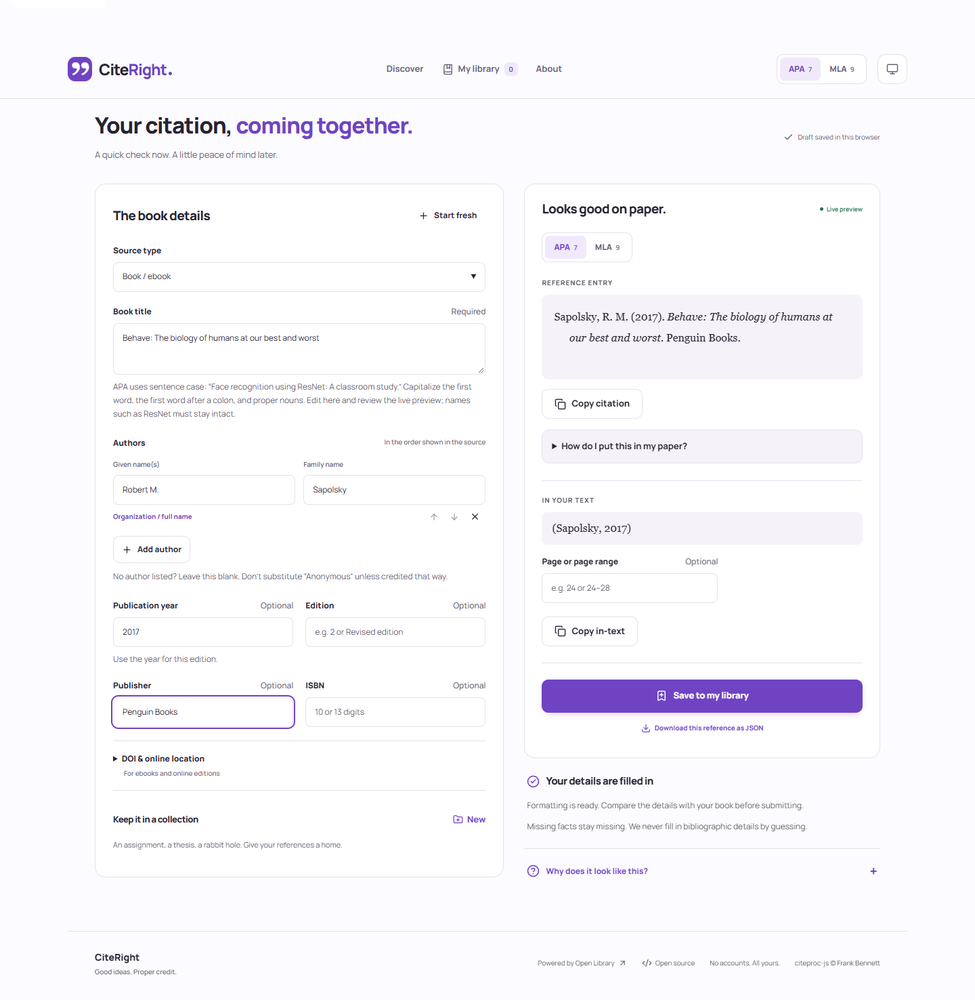
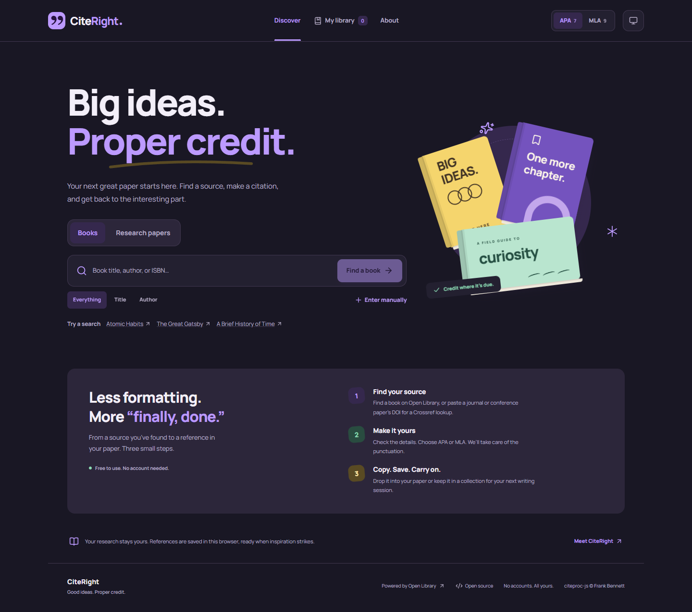
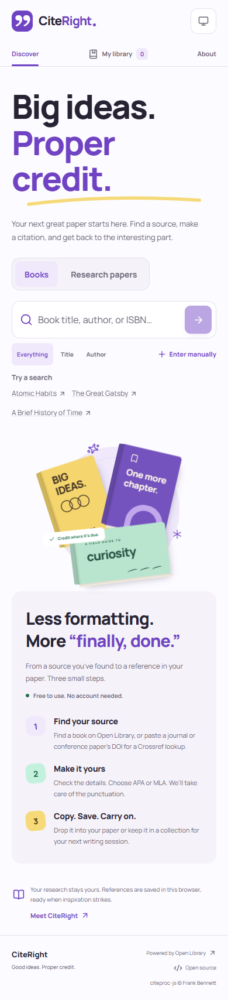

# CiteRight

**Big ideas. Proper credit.**

A free, open-source citation workspace for students, researchers, and academic writers. Find the right book edition or look up a journal article or published conference paper by DOI, generate APA 7 or MLA 9 citations, and keep your references together—without an account, database, or paid API.



## Features

- **Book discovery:** search by title, author, or ISBN using Open Library, with covers, paginated results, exact edition selection, and comparisons of up to three editions.
- **Journal articles:** paste a DOI or DOI link for a Crossref lookup. Review article title, ordered authors, journal, publication year, volume, issue, page range, and article number. Manual article entry works without a DOI.
- **Published conference papers:** DOI lookup preserves the proceedings title, publisher, pages, and credited editors, with appropriate APA/MLA formatting and BibTeX `@inproceedings` export.
- **Real CSL formatting:** bundled APA 7 and MLA 9 styles produce bibliography entries and parenthetical citations with optional pages or page ranges. No runtime style download.
- **Rich copying:** copy citations or alphabetized reference lists with italics and hanging indents when your browser and destination support HTML. Plain-text fallback is clearly announced.
- **Manual citation studio:** choose Book / ebook, Journal article, or Conference paper (published proceedings) to see the appropriate editable fields, with live previews and clickable metadata checks.
- **Helpful explanations:** optional APA/MLA formatting guidance, source links, and honest missing-data messages. No invented facts or accuracy scores.
- **Your own library:** save, edit, remove and undo; detect duplicates; browse list or cover-grid views; filter references and select a subset for copying or export.
- **Collections:** create, rename, and remove assignment/project collections. A reference can belong to more than one. Deleting a collection keeps its references.
- **Draft recovery:** automatically preserve the active editor draft. Opening a different searched book or article asks before replacing it.
- **Portable research:** export BibTeX or versioned JSON; preview JSON imports before merging. Duplicate references are skipped without overwriting existing details.
- **A little personality:** animated book artwork, staggered results, copy confirmations, and a save-to-library animation. Responsive light/dark themes and reduced-motion support.
- **Privacy by default:** no accounts, app database, analytics, tracking scripts, or hardcoded secrets.

## Screenshots

Actual application renders; the editor example uses APA's published Sapolsky book example. Decorative book artwork is original CSS geometry, not catalog metadata.

The journal article screenshots show the live Crossref record for APA's Grady example.

| Article lookup                                                     | Article citation studio                                                     |
| ------------------------------------------------------------------ | --------------------------------------------------------------------------- |
|  |  |

| Citation studio                                                   | Dark mode                                            |
| ----------------------------------------------------------------- | ---------------------------------------------------- |
|  |  |

<details>
<summary>Mobile screenshot</summary>



</details>

## Technology

React 19 · TypeScript · Vite · Tailwind CSS 4 · shadcn/ui-style local components built on Radix primitives · React Router · Citation.js / citeproc-js · Zod · DOMPurify · Lucide · self-hosted Manrope.

Vitest and React Testing Library support unit tests; Playwright and axe-core cover browser flows and accessibility. Exact dependency versions are recorded in `package.json` and `package-lock.json`.

## Install and run locally

Install **Node.js 22.12+** (Node 24 LTS recommended), npm, Git, and optionally VS Code.

1. Clone `https://github.com/H1R0000/citeright.git`, or download its source ZIP and extract it.
2. Open the project folder in VS Code.
3. Open the integrated terminal in that folder and run:

```sh
npm install
npm run dev
```

Open the Local URL printed by Vite, normally `http://127.0.0.1:5173`.

No environment variables, Vercel credentials, Supabase project, or database are needed. An internet connection is needed to install dependencies and search Open Library or Crossref. Manual citation generation runs locally once the application has loaded.

### Production build

```sh
npm run build
npm run preview
```

Vite writes static files to `dist`. Preview normally runs at `http://127.0.0.1:4173`. Libraries are stored per origin, so the development and preview ports have separate saved data. Export/import JSON to transfer your library.

### Commands

| Command              | Purpose                                                     |
| -------------------- | ----------------------------------------------------------- |
| `npm run dev`        | Start the local development server                          |
| `npm run build`      | Type-check and build `dist`                                 |
| `npm run preview`    | Serve the production build locally                          |
| `npm run typecheck`  | Check application and tooling types                         |
| `npm run lint`       | ESLint checks                                               |
| `npm test`           | Deterministic unit tests                                    |
| `npm run test:watch` | Watch unit tests during development                         |
| `npm run test:e2e`   | Build and test the production preview on desktop and mobile |
| `npm run check`      | Lint, unit tests, and production build                      |

For browser tests, first install the test browser:

```sh
npx playwright install chromium
npm run test:e2e
```

On Linux CI, use `npx playwright install --with-deps chromium`. To use an existing Edge installation on Windows, set `$env:PLAYWRIGHT_CHANNEL = 'msedge'` in PowerShell before running the browser tests. This is optional test tooling, not application configuration.

## Deploy to Vercel

1. Publish the source to your GitHub repository.
2. In Vercel, import that repository as a new project.
3. Select **Vite**, leave the project root at the repository root, and use:
   - Install: `npm ci`
   - Build: `npm run build`
   - Output: `dist`
   - Node: 24.x, or another version satisfying the package engine requirement.
4. Deploy. No environment variables or backend services are required.
5. Verify search, a manual citation, save/reload, and direct navigation to `/library` and `/about` on your deployment.

`vercel.json` supplies static SPA rewrites and basic response headers. The app works within Vercel's free static-hosting offering, subject to Vercel's current plan terms and limits. Deployment was intentionally not performed as part of preparing this source.

The app links to [H1R0000/citeright](https://github.com/H1R0000/citeright). Fork maintainers can change `repositoryUrl` in `src/config.ts`. `private: true` in package.json prevents accidental npm publication; it does not prevent a public GitHub repository.

## How it works

```text
Search / ISBN
    → throttled, cached Open Library requests
    → choose a specific edition
    → normalize only that edition's metadata
    → review an editable Book record
    → CSL JSON → Citation.js / citeproc-js → sanitized HTML + plain text
    → copy, save to localStorage, or export
```

### Project structure

```text
src/
  app/          Routing, theme/preferences, library state and feedback
  assets/csl/   Pinned APA 7, MLA 9 and en-US locale sources
  components/   Reusable UI, book covers, copy and style controls
  features/     Search/editions, editor, library/collections, About
  lib/          Types, validation, Open Library, CSL, storage, transfer
  test/         Shared deterministic fixtures and test setup
tests/          Production-browser workflows and accessibility tests
scripts/        Optional screenshot and live-API smoke helpers
docs/           Screenshots, verification notes and source documentation
```

Bibliographic records are style-independent. They keep original edition identifiers and provenance, ordered personal or literal author names, timestamps, and collection IDs. Readiness checks identify omissions and malformed supplied values; they are not a factual accuracy assessment.

JSON exports use `{ version: 1, references, collections, exportedAt }`. Imports accept this application's version 1 format (not arbitrary CSL JSON), reject malformed data before writing, remap imported IDs, merge collection names case-insensitively, and skip duplicate bibliographic records. Limits: 5 MB per import, 5,000 references, 100 collections. Browser storage may fill sooner.

## Citation accuracy

### Citing a paper found on Google Scholar

1. Open the paper's publisher page from Google Scholar. Find the DOI, often near the title or in the paper's first-page details.
2. In CiteRight, choose **Research papers**, paste the DOI (such as `10.1037/ppm0000185`) or its `https://doi.org/` link, and click **Find paper**.
3. Choose **Review paper** and check the metadata against the published version. Select APA 7 or MLA 9.
4. Copy the full reference or add a quotation page and copy the in-text citation. Save it in the same library and collections as your books.

No DOI? Choose **Enter paper manually**, or select **Journal article** in the citation studio. CiteRight does not search or scrape Google Scholar, import Scholar result links, or extract metadata from PDFs. Automatic lookup currently covers journal articles and proceedings papers registered with Crossref, not every DOI registration agency or every research source type.

### Formatting and metadata

- Use the **selected edition's** publication year, publisher, ISBN, and edition statement. A work's first publication date is informational only.
- Missing metadata remains blank. CSL applies its own missing-author/date conventions.
- Imported names are editable suggestions. Multi-part names, name particles, organizations and mononyms require review.
- Review title capitalization: APA needs sentence case; MLA formats English titles in title case. The app does not blindly lowercase proper nouns.
- Open Library catalog links are provenance, not automatically inserted citation URLs. Enter the actual ebook location if relevant.
- In-text page ranges go through CSL rather than being appended by hand. Disambiguation uses the library in the editor and the chosen set when copying a bibliography; choose a consistent set for your final paper.
- Citation HTML is sanitized; metadata is not accepted as executable markup.
- Journal articles use CSL's `article-journal` type, not book formatting. Journal title, volume, issue, pages, and article numbers remain separate. APA uses the article number when supplied; quotation locators are independent of the article's full page range.
- Crossref lookup preserves supplied author order and names, strips publisher markup, and prefers the journal's print publication year when available, then published/online/issued dates. Creation and deposit dates are never substituted. Review the year against the version you used.
- The version 1 JSON schema now includes `type`, `journal`, `proceedings`, `editors`, `volume`, `issue`, `pages`, and `articleNumber`. Existing backups without these fields default to books when read by this version. Older releases should not be used to import new paper backups because they do not understand these fields.

Formatting tests use independently verified examples from [APA's Book/Ebook References](https://apastyle.apa.org/style-grammar-guidelines/references/examples/book-references) and [MLA's Citations by Format](https://style.mla.org/works-cited/citations-by-format/), plus edge cases for missing information, multiple authors, organizations, pages, sorting, DOI, and same-author/year disambiguation.

Article tests additionally verify [APA's journal article examples](https://apastyle.apa.org/style-grammar-guidelines/references/examples/journal-article-references) and [MLA's journal article DOI example](https://style.mla.org/page-range-and-doi/), including italics, article numbers, and BibTeX `@article` export.

## Crossref usage and attribution

Published conference papers (`proceedings-article` records) import as a separate `paper-conference` source type. The editor preserves proceedings title, publisher, full page range, publication year, and any credited editors. APA renders them as contributions to collected proceedings, including when no editors are supplied; MLA uses the proceedings container. BibTeX exports these as `@inproceedings`. Unpublished talks and presentations remain outside this workflow. Unknown DOI types are identified in the error message instead of being relabeled as journal articles.

Article metadata comes from [Crossref's public REST API](https://www.crossref.org/documentation/retrieve-metadata/rest-api/access-and-authentication/), using `GET https://api.crossref.org/works/{doi}`. No API key or backend is required. Lookup happens on explicit submission, with one request at a time, at least 1.1 seconds between starts, a 15-second request timeout, and at most three attempts for temporary server errors. Exposed rate-limit headers and `Retry-After` are respected; a long cooldown is surfaced instead of repeatedly polling.

Successful metadata responses are cached separately from Open Library, up to 100 records for 24 hours, with memory fallback when storage is unavailable. The query DOI is sent to Crossref; no paper PDF or full text is uploaded. Public deployment operators should review Crossref's current usage guidance, including its recommendation for a real operator contact through the polite pool. This client uses unauthenticated public access and does not invent contact details.

## Open Library usage and attribution

Book metadata and covers come from [Open Library](https://openlibrary.org), an Internet Archive initiative. See its [Search API](https://openlibrary.org/dev/docs/api/search), [edition and ISBN APIs](https://openlibrary.org/dev/docs/api/books), and [usage policy](https://openlibrary.org/developers/api).

- Text search debounces for 500 ms and starts at two characters.
- Metadata requests share a serial queue with at least 1.1 seconds between starts. The browser uses the anonymous-client rate; it does not try to forge a User-Agent header or claim the higher identified-client allowance.
- Up to 100 successful responses are cached locally for 24 hours. Redirected ISBN responses also cache the canonical edition URL.
- Results and editions are paginated. Authors load only for a selected edition. Covers load lazily using cover IDs.
- HTTP 429 and server failures honor `Retry-After` with at most three attempts. Long waits produce a recoverable message rather than silently polling. Obsolete requests are aborted.
- No scraping, bulk harvesting, paid fallback service, or proxy is used. CORS access works directly from localhost and static hosting.

Public operators should review the current policy and its application registration guidance before launch. Client-side throttling cannot coordinate all visitors sharing an IP; Open Library controls availability and limits. This project is for human-paced educational discovery, not high-traffic bulk metadata infrastructure.

## Privacy, accessibility and limitations

- LocalStorage is specific to a browser profile and origin. Clearing browser data removes your library; JSON is your backup and transfer mechanism. There is no cloud sync.
- One active editor draft is recovered. Starting fresh or confirming replacement changes that draft. Draft status reports storage failures; existing saved references are separate.
- Storage failure never produces a successful-save message. Corrupt data is preserved for a recovery download before an explicit reset. Concurrent tab updates are reflected, but simultaneous edits are not a collaborative merge system.
- Covers, names and metadata can be missing or inaccurate. Verify against your book and assignment requirements.
- This version covers whole authored books/ebooks, journal articles, and papers published in conference proceedings. General book chapters, whole edited collections, contributor-heavy translations, unpublished conference presentations, preprints, theses, narrative citations, and other source types are outside its supported editor fields. Special article cases such as retractions, advance online/in-press publications, seasons, and database-specific second containers may require manual adjustments after copying.
- Clipboard HTML requires browser support and a secure context (HTTPS or localhost). The destination application determines which formatting survives paste. Plain-text fallback is reported.
- The responsive interface supports keyboard operation, visible focus, labeled controls, dialog focus management and reduced motion. Automated axe checks complement rather than replace assistive-technology testing.
- The CSL engine is intentionally lazy-loaded on editor/library routes; its bundled styles and processor are larger than the basic search UI.
- No service worker or full offline/PWA installation is included. Saved metadata and formatting work without API calls after the app loads, but initial page loading still needs a running local server or reachable host.

## Contributing

See [CONTRIBUTING.md](CONTRIBUTING.md) for development and review expectations and [SECURITY.md](SECURITY.md) for vulnerability reporting. The bug-report template requests the source identifier, citation style, and expected versus actual output.

Imported single-letter family names receive a targeted review warning. This is a prompt to check the source, not proof of incorrect metadata. Title capitalization stays under your control, and the citation studio includes guidance for pasting into Word or Google Docs.

Open an issue in your published repository for a reproducible bug or a proposed improvement. Before submitting a change, run `npm run check` and `npm run test:e2e`. Add a verified citation fixture for formatting changes and an edition regression fixture for metadata changes. Keep API requests human-paced and never add fabricated defaults for missing fields.

## License

CiteRight's application code is [MIT licensed](LICENSE). Dependencies, citation styles, fonts and source metadata retain their own licenses. See [THIRD_PARTY_NOTICES.md](THIRD_PARTY_NOTICES.md) for attribution and bundled source revisions. In particular, the official CSL styles/locale use CC BY-SA 3.0; citeproc-js and the Manrope font are not relicensed by the application's MIT license.
